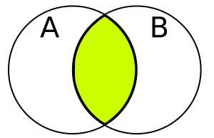
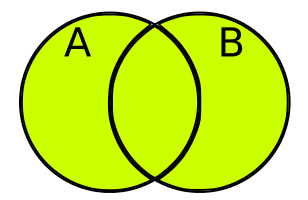
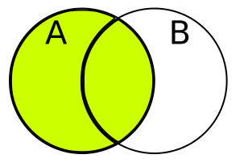
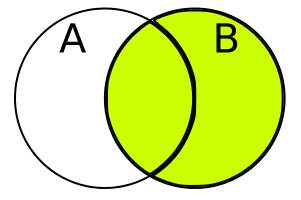
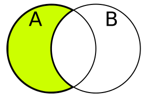
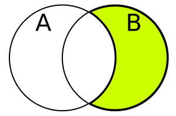

# Join types guide

## Inner Join

### Matching rows between A and B.
#### SQL equivalent: 
```sql
SELECT *
FROM A
JOIN B ON A.column = B.column
```
---
## Full Outer Join

### Rows from A and B, with matching or not.
#### SQL equivalent: 
```sql
SELECT *
FROM A
FULL JOIN B ON A.column = B.column
```
---
## Left Outer Join

### Rows from A, matching with B or not.
#### SQL equivalent: 
```sql
SELECT *
FROM A
LEFT JOIN B ON A.column = B.column
```
---
## Right Outer Join

### Rows from B, matching with A or not.
#### SQL equivalent: 
```sql
SELECT *
FROM A
RIGHT JOIN B ON A.column = B.column
```
---
## Left Anti Join

### Rows from A with no match with B.
#### SQL equivalent:
```sql
SELECT *
FROM A
LEFT JOIN B ON A.column = B.column
WHERE B.column IS NULL
```
---
## Right Anti Join

### Rows from B with no match with A.
#### SQL equivalent:
```sql
SELECT *
FROM A
RIGHT JOIN B ON A.column = B.column
WHERE A.column IS NULL
```
---
## Left Semi Join

### Rows from A matching with B.
#### Similar to Inner Join but without containing data from B.
#### SQL equivalent:
```sql
SELECT *
FROM A
WHERE column IN (
    SELECT column
    FROM B
)
```
---
## Right Semi Join

### Rows from B matching with A.
#### Similar to Inner Join but without containing data from A.
#### SQL equivalent:
```sql
SELECT *
FROM B
WHERE column IN (
    SELECT column
    FROM A
)
```